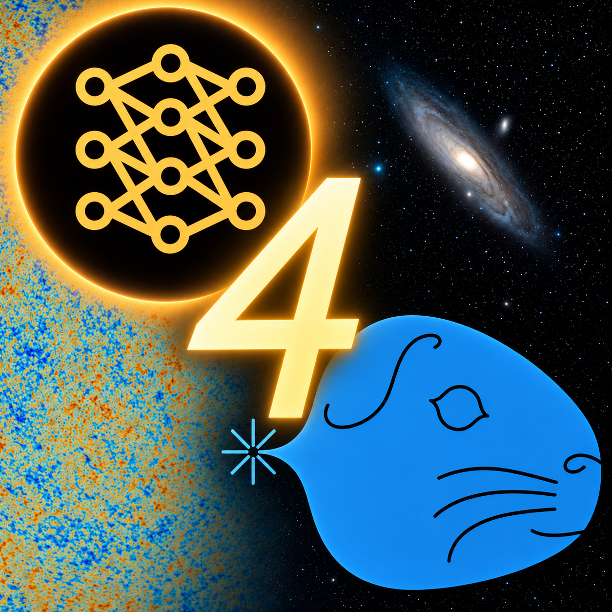

  

# cosmopower4cobaya

This is a landing repository. The actual code and development happen in the corresponding private repository, which eventually will be made public.

The repository holds the **emulators for CMB angular power spectra** trained with [CosmoPower](https://alessiospuriomancini.github.io/cosmopower/) of the five cosmological models: 
* $\Lambda\mathrm{CDM}$: baseline model,
* $\Lambda\mathrm{CDM}+\sum{m_\nu}$: extension with 3 degenerate neutrino masses,
* $\Lambda\mathrm{CDM}+\Omega_K$: extension with non-zero spatial curvature,
* $w\mathrm{CDM}$: extension with constant equation-of-state parameter,
* $w_0w_a\mathrm{CDM}$: extension with evolving dark energy.

**Interface with [Cobaya](https://github.com/CobayaSampler/cobaya):** Additionally, the repository hosts the code for interfacing these emulators with the sampling code and likelihood repository [Cobaya](https://github.com/CobayaSampler/cobaya).

## Private Repository

The main repository is located at:
**https://github.com/lukashergt/cosmopower4cobaya_private**

This repository is private for now and requires explicit access permission.

## Requesting Access

If you would like to access the private repository, please:
1. Send a request to the repository owner: [@lukashergt](https://github.com/lukashergt)
2. Include your GitHub username.
3. Briefly describe your intended use case.

Access will for now be granted only on an individual basis. 

## Resources

- **Zenodo**: https://doi.org/10.5281/zenodo.18496170
- **Paper**: arXiv link (TBD)

## About

`cosmopower4cobaya` integrates CosmoPower emulators with the [Cobaya](https://github.com/CobayaSampler/cobaya) framework for efficient cosmological parameter inference.

For more information, documentation, and source code, please request access to the private repository.
